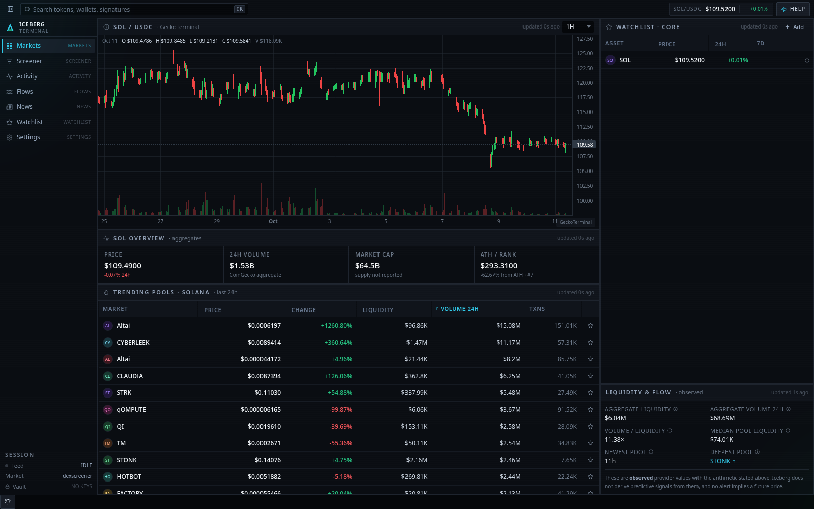
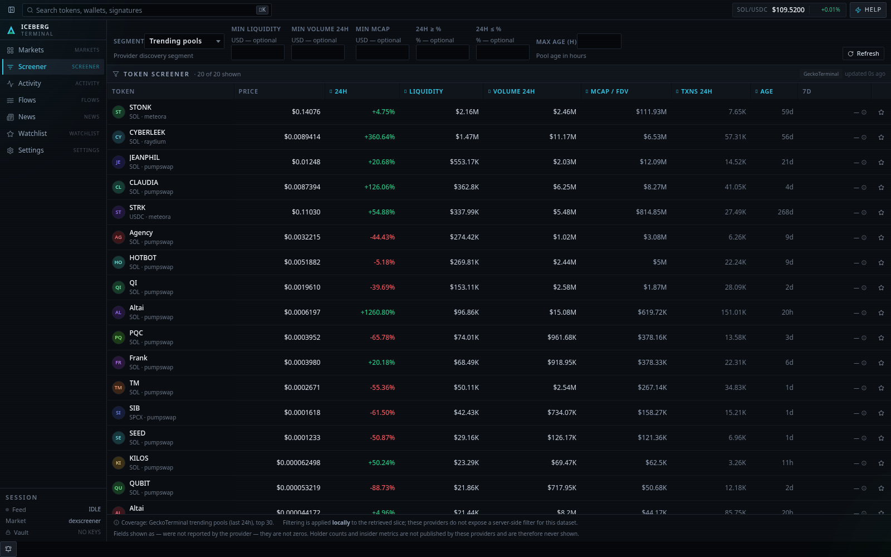
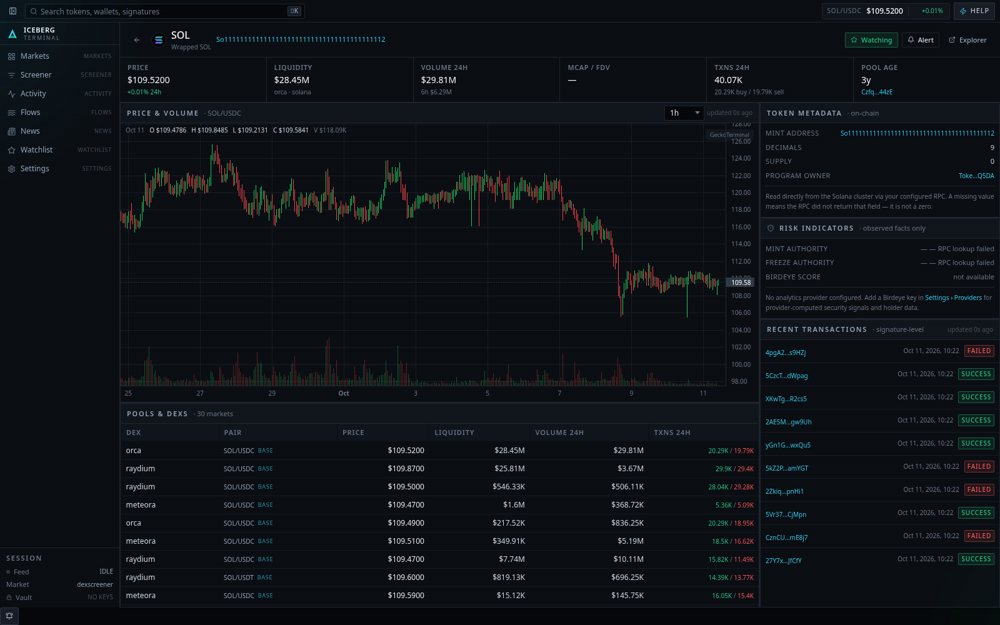
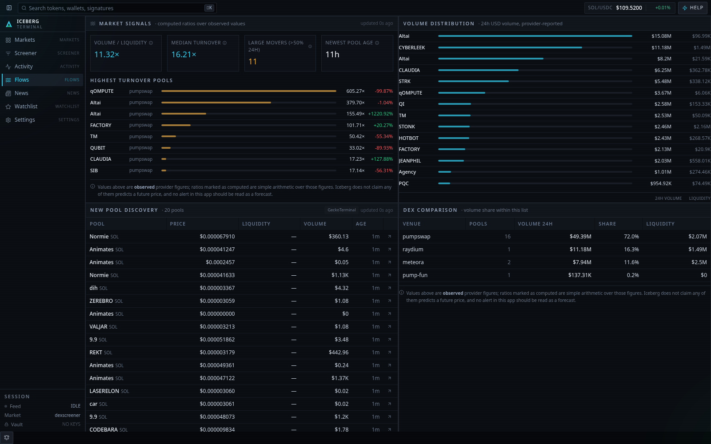
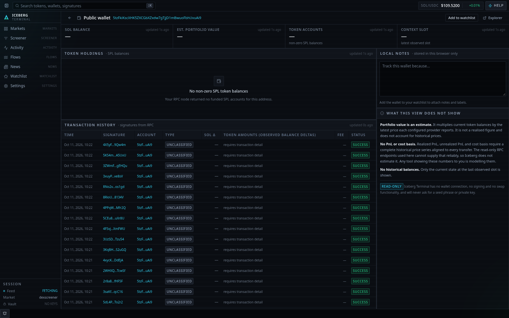
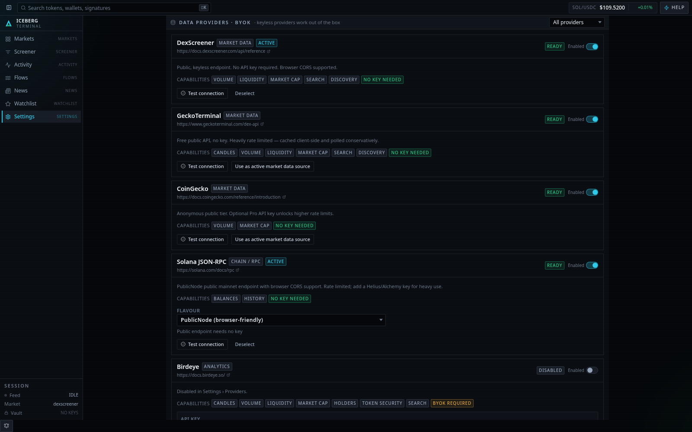
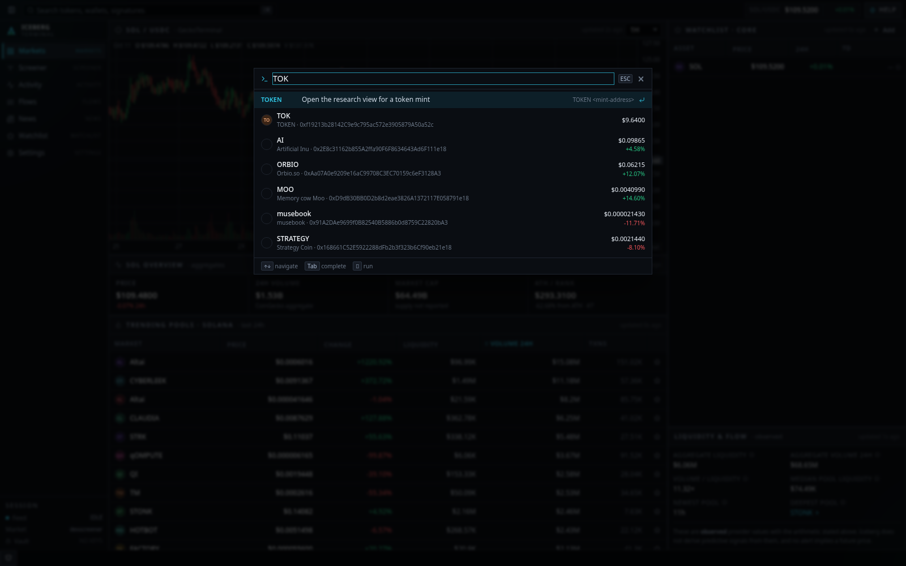

<div align="center">

# ❄ Iceberg Terminal

**Open-source, BYOK crypto intelligence terminal for Solana and beyond.**

A free, browser-based research workstation — dense like a trading terminal,
honest like an auditor.

[](LICENSE)
[](tsconfig.app.json)
[](package.json)
[](vite.config.ts)
[](SECURITY.md)
[](SECURITY.md)

</div>

---

## What it is

Iceberg Terminal is a free, open-source cryptocurrency intelligence workstation
that runs entirely in your browser. It combines real-time DEX market data,
OHLCV charts, token screening, on-chain activity, wallet tracking, liquidity
analytics and news into a keyboard-driven multi-panel interface.

It runs with **zero configuration**. Three market-data providers work keyless
out of the box. Optional premium providers are bring-your-own-key and are never
required.

There is **no account, no subscription, no server and no watermark**. Your
watchlists, notes and credentials stay in your browser.

---

## Screens

**Markets — SOL/USDC workstation**



**Token screener**



**Token research**



**Liquidity & flows**



**Wallet intelligence**



**Providers & BYOK settings**



**Command palette**



---

## Features

### Markets

- SOL/USDC candlestick chart with volume histogram, seven timeframes (1m → 1w)
- Price, 24h volume, market cap and ATH tiles from the configured providers
- Trending Solana pools ranked by liquidity, volume or change
- Watchlist rail with price, 24h change and sparklines
- The reference SOL/stablecoin pool is resolved at runtime from the deepest real
  pool rather than hard-coded

### Token screener

- Searchable, sortable, filterable by liquidity, volume, market cap,
  percentage change and pool age
- Four provider discovery segments (trending pools, new pools, boosted tokens,
  profiled tokens)
- Coverage limitations stated in the UI — these providers return a bounded,
  curated slice of Solana, not the full token universe
- Null-aware sorting: unknown values always sort last, never as zero

### Token research

- Price/volume chart on the deepest pool, plus the full pool and DEX table
- On-chain mint metadata straight from the RPC: decimals, supply, mint and
  freeze authority, owning program
- Risk indicators from **observed facts only** — no locally-invented safety
  score
- Recent signatures with explorer links
- Mint address as the canonical identifier; symbols are display-only because they
  collide and are trivially spoofed on Solana

### On-chain activity

- Polled signature feed for watched public wallets
- Filters by transaction type and by address
- Classification is limited to what the parsed instructions encode. Iceberg does
  **not** label transactions as buys, sells, accumulation or liquidity adds —
  those claims need data the RPC does not reliably provide

### Wallet intelligence

- SOL balance, SPL token holdings, transaction history
- Mark-to-market portfolio estimate from current provider prices
- Local labels and notes, never transmitted anywhere
- A first-class panel listing exactly what the view does **not** show: no PnL,
  no cost basis, no historical balances

### Liquidity & flows

- Turnover ratios, volume distribution, new-pool discovery, DEX comparison
- Watched-token events
- Observed values and computed ratios are visually distinguished, and every
  ratio states its arithmetic in a tooltip

### News

- CryptoPanic-backed feed with search and tag filtering
- Source, timestamp, author and source link on every item
- With no provider configured you get setup instructions and an empty state —
  **never a fabricated headline**

### Watchlists & alerts

- Multiple local token lists and a public-wallet watchlist
- Local per-asset and per-wallet notes
- Price-above/below, 24h change and volume-spike alerts
- Configurable polling interval, optional browser notifications (with explicit
  permission), and an in-app alert inbox
- Honest about its limits: alerts evaluate **while the tab is open**. There is
  no background service and no push server.

### Command interface

Press `⌘K` / `Ctrl+K` anywhere.

| Command | Action |
| --- | --- |
| `HELP` | Command reference |
| `MARKETS` / `SOL` | Market and Solana overview |
| `TOKEN <mint>` | Token research by mint address |
| `WALLET <address> [label]` | Public wallet analysis + add to watchlist |
| `TX <signature>` | Transaction inspector |
| `SCREENER` / `ACTIVITY` / `FLOWS` / `NEWS` / `WATCHLIST` / `SETTINGS` | Navigate |
| `WATCH <mint>` | Toggle watchlist membership |
| `DEMO ON\|OFF` | Toggle deterministic demo data |
| `REFRESH` | Invalidate cached provider data |

The same input doubles as global search for tokens, public wallet addresses and
transaction signatures. Full history, `Tab` autocomplete and contextual
suggestions included.

---

## Install & run

**Requirements:** Node.js ≥ 20.19 and a modern browser.

```bash
git clone https://github.com/farhajmaaz-eng/iceberg-terminal.git
cd iceberg-terminal
npm install
npm run dev
```

Open the printed local URL. No API key required.

### Production build

```bash
npm run build      # type-check + bundle to dist/
npm run preview    # serve the production build
```

### Development commands

| Command | Description |
| --- | --- |
| `npm run dev` | Dev server with hot reload |
| `npm run build` | `tsc -b` then build to `dist/` |
| `npm run preview` | Serve the production build |
| `npm run lint` | ESLint |
| `npm run typecheck` | TypeScript only |
| `npm test` | Vitest unit + component suite |
| `npm run test:watch` | Vitest watch mode |
| `npm run test:e2e` | Playwright (requires `npx playwright install chromium`) |
| `npm run check` | lint → typecheck → test → build |

---

## Deployment

The build output in `dist/` is a fully static site. There is no server component.

```bash
npm run build
```

Deploy `dist/` to any static host:

- **GitHub Pages** — the router is a `HashRouter`, so no rewrite rules are needed
- **Netlify / Vercel / Cloudflare Pages** — build `npm run build`, publish `dist`
- **S3 + CloudFront** — upload `dist/`, serve `index.html` for unknown paths

Because the router uses hashes, **no SPA rewrite configuration is required**
anywhere.

### Offline / demo mode

Set `VITE_FORCE_DEMO_MODE=true` before building to run entirely on deterministic
synthetic data. Useful for screenshots, demos and offline review. Demo values are
always labelled with a banner and a `DEMO DATA` badge and are never presented as
live prices.

### Environment variables

Only **non-secret** defaults belong in `.env` — anything prefixed `VITE_` is
inlined into the public bundle.

```bash
VITE_DEFAULT_RPC_FLAVOUR=public      # public | solana-foundation | helius | alchemy | custom
VITE_DEFAULT_RPC_URL=                # only for VITE_DEFAULT_RPC_FLAVOUR=custom
VITE_DEFAULT_MARKET_PROVIDER=dexscreener
VITE_FORCE_DEMO_MODE=false
VITE_TELEMETRY_ENDPOINT=             # unused — Iceberg ships no telemetry
```

See `.env.example`. **Never commit a `.env` containing secrets.**

---

## Providers (BYOK)

Full detail in [`docs/PROVIDERS.md`](docs/PROVIDERS.md).

| Provider | Category | Key required | Notes |
| --- | --- | --- | --- |
| [DexScreener](https://docs.dexscreener.com/api/reference) | Market | No | Pool data, liquidity, volume, search, discovery |
| [GeckoTerminal](https://www.geckoterminal.com/dex-api) | Market | No | OHLCV candles, trending/new pools |
| [CoinGecko](https://docs.coingecko.com/reference/introduction) | Market | No | Whole-coin aggregates (SOL mcap, ATH, supply) |
| [Solana JSON-RPC](https://solana.com/docs/rpc) | Chain | No | PublicNode / Helius / Alchemy / custom |
| [Birdeye](https://docs.birdeye.so/) | Analytics | **Yes** | Token security, holders, rug flags |
| [CryptoPanic](https://cryptopanic.com/developers/api/) | News | **Yes** | Headlines with source links |

### BYOK behaviour

- Keys are entered in **Settings › Providers** and stored **only in your
  browser**.
- With a passphrase, each key is encrypted at rest with AES-GCM
  (PBKDF2-SHA256, 210 000 iterations). Without one, storage is weak obfuscation
  and the UI labels it honestly as such.
- Keys are held in memory for the lifetime of the tab and are **never** written
  to `localStorage`, logs, error messages or export files.
- Keys are sent **only** to the provider they belong to, over HTTPS.
- Every provider has an enable/disable toggle, a connection test with latency,
  clear authentication and rate-limit errors, and automatic capability detection.
- Adding a provider means implementing one interface and registering it — no UI
  changes required.

Capabilities are not evenly distributed across providers, so the app resolves
them by **capability**, not by "the selected market provider". Selecting
DexScreener for market data does not break your charts; GeckoTerminal serves
those.

---

## Security limitations

Read [`SECURITY.md`](SECURITY.md) in full. The short version:

- **Browser storage is not a vault.** A passphrase protects a key at rest against
  someone reading the IndexedDB file. It does **not** protect the key while the
  app is running, nor against a compromised device, a malicious extension or
  script injection. Browser-side encryption is defence-in-depth, not secrecy.
- **Vite `VITE_*` variables are public** — they ship in the bundle. Only
  non-secret defaults belong in `.env`.
- **Nothing is encrypted in transit to you** — there is no server, so there is
  nothing to encrypt to.
- Iceberg Terminal ships **no telemetry** and sends no keys, addresses or
  watchlists to any first-party endpoint.
- The app is **read-only**: no wallet connection, no signing, no swaps, no
  transaction submission.
- **It never asks for a seed phrase or private key.** There is no input for one
  anywhere in the codebase.
- Credentials are **excluded from workspace exports** by construction, and
  imports are **atomic** — every record lands in a single transaction, so a
  failure rolls back completely rather than leaving a half-restored workspace.
- A locked credential vault blocks **reads and writes**, cannot be silently
  reopened by saving another key, and cannot be downgraded to unencrypted
  storage. Local vault records are bounds-checked before any key derivation.

---

## Data integrity

This is the project's defining constraint.

- **Every displayed metric** comes from a real provider, a transparent calculation
  whose arithmetic is shown, or clearly labelled demo data.
- **A missing value is never shown as `0`.** Unknown renders as `—`. This holds
  for *totals* too: a transaction count is reported only when both the buy and
  sell components are known.
- **Storage failure is never shown as empty data.** If IndexedDB is blocked or
  full, a banner says so rather than presenting an empty watchlist.
- **Demo data is never presented as live.** It always carries a banner and a
  badge, and it is only produced when demo mode is on or a provider genuinely
  cannot serve the data. A provider failure with demo mode off shows a real
  error instead of synthetic numbers.
- **Transactions are not classified by intent.** No buy/sell/accumulation/liquidity
  labels from heuristics.
- **No fabricated headlines.** News requires a configured provider or you get an
  empty state.
- **No invented holder counts, insider activity or safety scores.**
- **No PnL or cost basis** from data that cannot support it.
- Untrusted token metadata and news are rendered as text, never as HTML.
- Every panel states whether a value is observed or computed, and what the
  formula is.

---

## Project structure

```
src/
  components/   Design system, charts, tables, app shell
  data/         Query hooks, capability routing, demo-fallback policy
  features/     markets · screener · token · wallet · activity · flows ·
                news · watchlist · settings · command · help · tx
  lib/          http · errors · redact · crypto · idb · format · demo · workspace
  providers/    Adapters, registry and normalized models
  store/        zustand stores (providers, vault, watchlists, wallets, alerts)
  types/        Canonical domain models
e2e/            Playwright end-to-end specs
docs/           ARCHITECTURE.md · PROVIDERS.md
```

Design rationale is in [`docs/ARCHITECTURE.md`](docs/ARCHITECTURE.md).

---

## Testing

```bash
npm test          # 264 unit + component tests
npm run test:e2e  # 26 end-to-end tests against the production build
```

Coverage focuses on the negative cases that keep this project honest:

- Provider normalization, including malformed and partial payloads
- Missing data staying `null` rather than becoming `0`
- Error taxonomy, retry policy, cancellation, deduplication, rate limiting
- Secret redaction (asserting the secret is absent from output)
- Vault envelope validation, encryption round-trip, and lock-state transitions
- Local persistence, storage-failure reporting, and hostile-import rejection
- Atomic workspace import and lossless export round-trips
- Command parsing and argument validation
- Screener filtering and flow-statistic correctness

---

## Contributing

See [`CONTRIBUTING.md`](CONTRIBUTING.md). The one rule that outranks convenience:

> Never make the app show a number it cannot source.

---

## Data sources & attribution

- Market data by [DexScreener](https://dexscreener.com)
- Onchain market data by [GeckoTerminal](https://www.geckoterminal.com) (CoinGecko)
- Coin aggregates by [CoinGecko](https://www.coingecko.com)
- On-chain data from your configured [Solana RPC](https://solana.com) node
- Optional: [Birdeye](https://birdeye.so), [CryptoPanic](https://cryptopanic.com)

Iceberg Terminal is MIT licensed and **not affiliated with any of the providers
above**. Data belongs to its respective owner — review each provider's terms
before commercial use.

---

## Disclaimer

Iceberg Terminal is research software, not investment advice. It makes no
predictions; no alert or pattern it displays should be read as a forecast.
Verify anything that matters against the chain and the underlying providers.

---

## License

[MIT](LICENSE) © 2026 Iceberg Terminal contributors